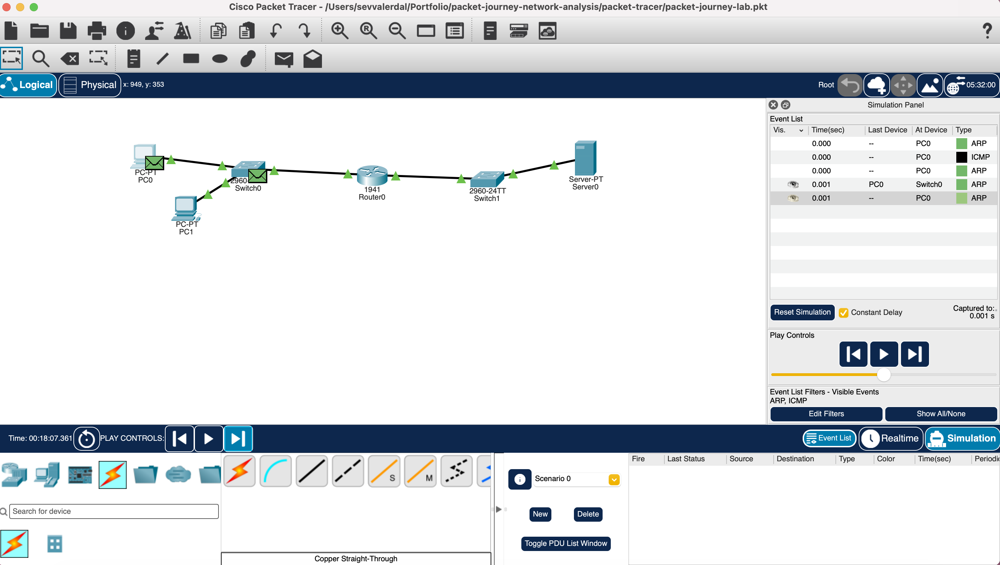
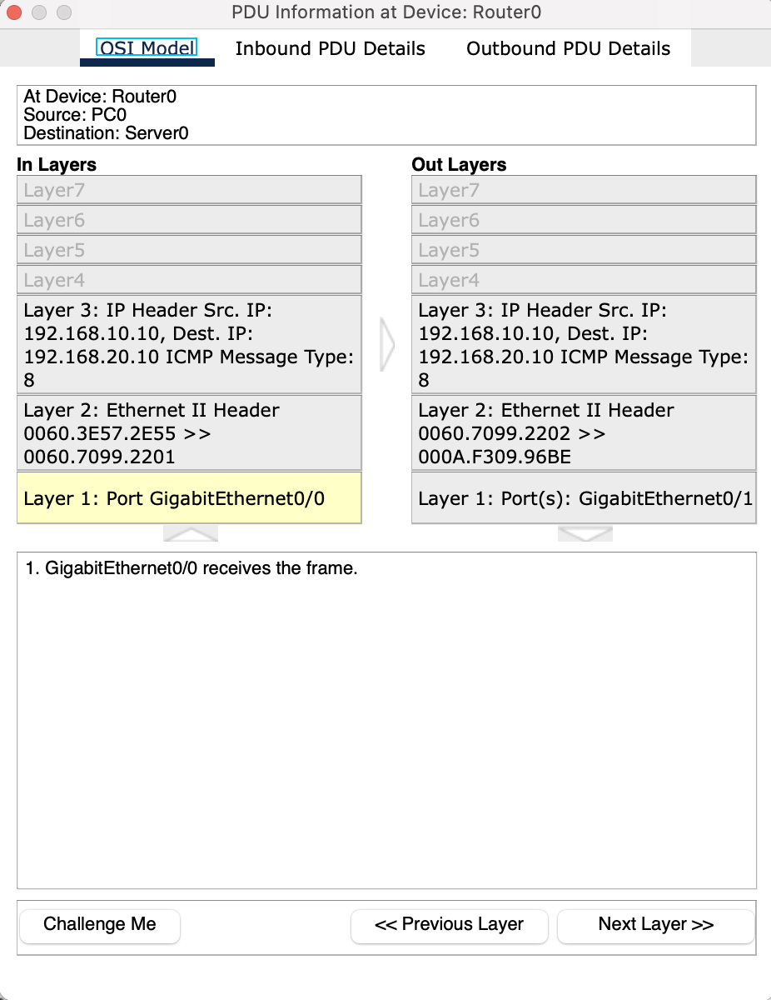
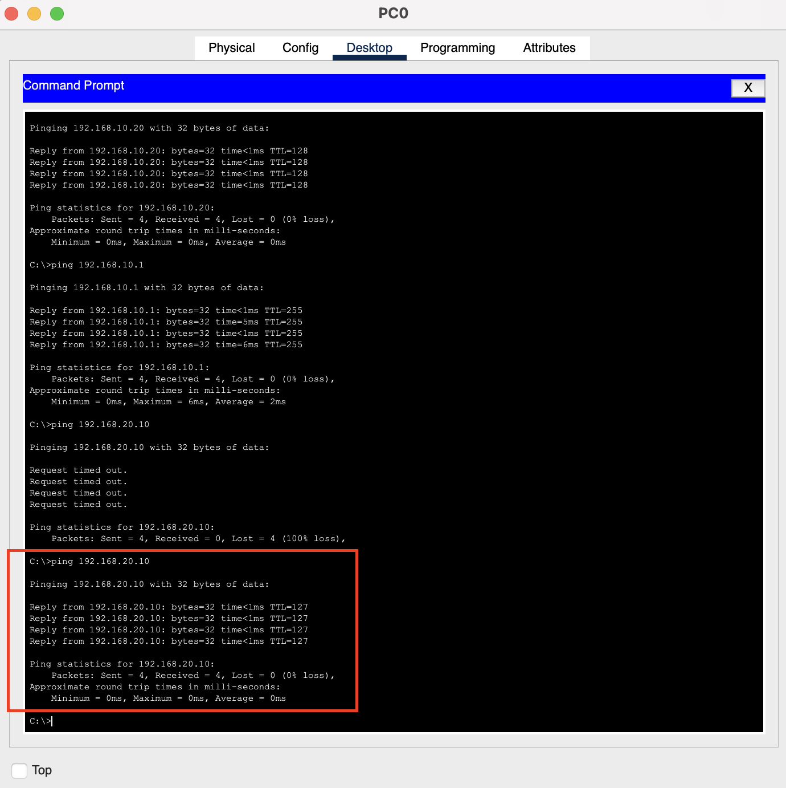
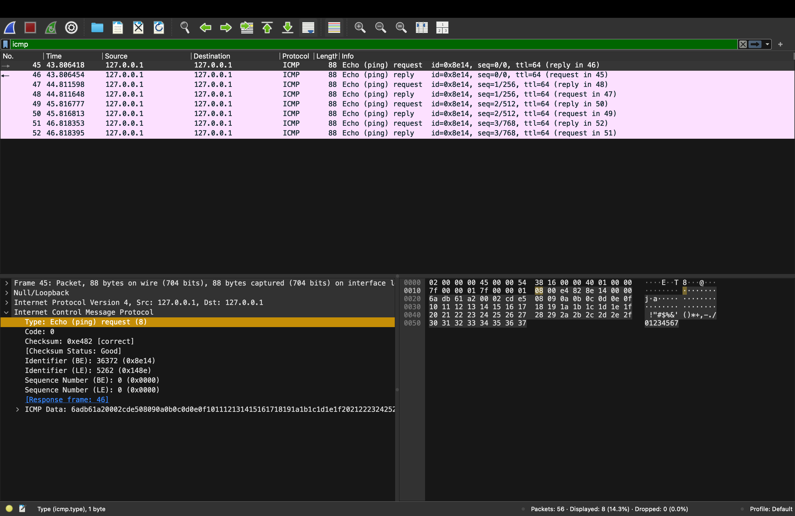
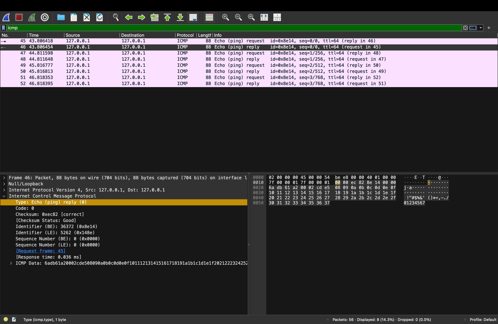

# Packet Journey: From ARP to ICMP Across Networks

**A reproducible Cisco Packet Tracer and Wireshark learning lab covering local and remote delivery, packet headers, and gateway troubleshooting.**

This project answers a practical question: **when a computer sends a packet to another network, which device receives the Ethernet frame first, and what changes when a router forwards it?** It pairs step-by-step Packet Tracer observations with a small real ICMP capture on macOS.

> **Scope:** Foundational network analysis and troubleshooting, not a production network, a penetration test, or an end-to-end capture of the public Internet.

## What this project demonstrates

- **Local vs. remote destinations:** when a host delivers directly on the local subnet and when it uses a default gateway.
- **ARP:** resolving a local next-hop IPv4 address to a MAC address before Ethernet delivery.
- **Layer 2 vs. Layer 3:** Ethernet source/destination MAC addresses change at a routed hop; the packet's source/destination IPv4 addresses remain the same in this un-NATed example.
- **TTL and ICMP:** the router decrements the request's TTL; the server creates a **new** reply with its own TTL.
- **Fault isolation:** a wrong gateway breaks access to remote networks while local-subnet access remains available.
- **Wireshark comparison:** real ICMP Echo Request (Type 8) and Echo Reply (Type 0), with matching sequence numbers, observed on the Mac loopback interface.

## Lab topology

```text
PC0 (192.168.10.10) ---+
                       +-- Switch0 -- [G0/0] Router0 [G0/1] -- Switch1 -- Server0 (192.168.20.10)
PC1 (192.168.10.20) ---+                 .10.1       .20.1
```

| Device       | IPv4 address / mask | Default gateway | Role                       |
| ------------ | ------------------- | --------------- | -------------------------- |
| PC0          | `192.168.10.10/24`  | `192.168.10.1`  | Source host                |
| PC1          | `192.168.10.20/24`  | `192.168.10.1`  | Same-subnet peer           |
| Router0 G0/0 | `192.168.10.1/24`   | —               | Gateway for the PC LAN     |
| Router0 G0/1 | `192.168.20.1/24`   | —               | Gateway for the server LAN |
| Server0      | `192.168.20.10/24`  | `192.168.20.1`  | Remote destination         |



**Important distinction from a router-on-a-stick lab:** this topology uses **two physical routed interfaces**, G0/0 and G0/1, rather than 802.1Q subinterfaces on one physical port.

## Experiments and observed results

| Scenario                       | Test or observation                          | Observed outcome                                                                              |
| ------------------------------ | -------------------------------------------- | --------------------------------------------------------------------------------------------- |
| **A. Local communication**     | PC0 ↔ PC1 (`192.168.10.0/24`)                | Local-subnet communication tested in Packet Tracer; see existing Scenario A evidence          |
| **B. Remote communication**    | PC0 → Server0 ping                           | First set: 3/4 replies; repeat: **4/4 replies**, with reply TTL **127**                       |
| **B. ARP next-hop resolution** | PC0 ARPs for `192.168.10.1`                  | Gateway responds; PC1 sees the broadcast but is not the requested IP                          |
| **B. Packet forwarding**       | Inspect ICMP at Router0 inbound vs. outbound | IPv4 endpoints unchanged; Ethernet MAC addresses rewritten; request TTL **255 → 254**         |
| **B. Return traffic**          | Server0 → PC0 Echo Reply                     | ICMP **Type 0**; return packet TTL **128 → 127**                                              |
| **C. Wrong gateway**           | Set only PC0's gateway to `192.168.10.254`   | PC1 and real router still reachable (**4/4** each); remote server unreachable (**0/4**)       |
| **C. Recovery**                | Restore PC0 gateway to `192.168.10.1`        | Remote server reachable again (**4/4**), reply TTL **127**                                    |
| **D. Wireshark**               | `ping -c 4 127.0.0.1` on `lo0`               | **4 ICMP Echo Requests + 4 Echo Replies**, with matching sequence numbers; TTL **64** on both |

**Scenario A screenshots:** [local ARP request and reply](screenshots/scenario-a-local/local-arp-request-reply.png) and [direct ICMP/MAC delivery](screenshots/scenario-a-local/local-icmp-direct-mac-delivery.png).

The initial remote ping's single timeout is an observed result; its precise cause was **not independently verified**, so it is not claimed as proven ARP delay.

## Packet-level evidence: the most important comparison

During the **PC0 → Server0** Echo Request, the router performed the following Ethernet forwarding step:

| Field                    | Router0 inbound (G0/0)         | Router0 outbound (G0/1)        |
| ------------------------ | ------------------------------ | ------------------------------ |
| Ethernet source MAC      | `0060.3E57.2E55` (PC0)         | `0060.7099.2202` (Router G0/1) |
| Ethernet destination MAC | `0060.7099.2201` (Router G0/0) | `000A.F309.96BE` (Server0)     |
| IPv4 source              | `192.168.10.10`                | `192.168.10.10`                |
| IPv4 destination         | `192.168.20.10`                | `192.168.20.10`                |
| TTL                      | **255**                        | **254**                        |

**Interpretation:** the IP destination represents the **final recipient**, while the destination MAC identifies the **next local Ethernet delivery**. A router forwards the IP packet into a new Layer 2 frame, and it decreases TTL by one.



See [Packet observations](docs/packet-observations.md) for a field-by-field reading guide.

## Troubleshooting: why the wrong gateway matters

PC0 retained `192.168.10.10/24`, but its default gateway was deliberately changed from `192.168.10.1` to unused `192.168.10.254`.

- **Local host** `192.168.10.20` continued to respond, since it was on the same subnet.
- **Real router** `192.168.10.1` remained reachable directly on that subnet.
- **Remote server** `192.168.20.10` stopped responding, since the configured next hop was incorrect.
- Correcting the gateway to `192.168.10.1` restored the remote ping.



See [Troubleshooting record](docs/troubleshooting.md).

## Wireshark: a real, but different, experiment

On macOS, Wireshark **4.6.9** captured traffic on the **`lo0` loopback interface** while the host ran:

```bash
ping -c 4 127.0.0.1
```

The filtered capture showed eight ICMP packets: four **Type 8** requests and four **Type 0** replies. Corresponding pairs shared the same ICMP sequence number (0, 1, 2, 3). Both source and destination IPv4 addresses were `127.0.0.1`, and observed TTL values were `64`.





**Scope boundary:** this is **not** a capture from the simulated Router0–Server0 path. Loopback does not traverse Ethernet or an external router, so the local capture does not demonstrate ARP, Ethernet MAC rewriting, or TTL decrement. Those mechanisms are demonstrated in **Packet Tracer**. This comparison verifies the ICMP message structure in a real operating system, not identity of the two packet paths.

A raw capture file is **not published**: the initial capture contained packets beyond those shown by the `icmp` display filter. Screenshots contain only selected evidence.

## Reproduce the lab

1. Open [`packet-tracer/packet-journey-lab.pkt`](packet-tracer/packet-journey-lab.pkt) in **Cisco Packet Tracer** (a compatible version required).
2. Check the addresses and default gateways against the topology table.
3. In **Realtime** mode, run `ping 192.168.10.20` and `ping 192.168.20.10` from PC0.
4. In **Simulation** mode, filter for ARP and ICMP. Observe PC0's gateway ARP, the router's inbound/outbound ICMP PDU details, and the server's Echo Reply.
5. To reproduce the fault, temporarily set **only** PC0's default gateway to `192.168.10.254`, compare local vs. remote ping, and restore `192.168.10.1` afterward. Save the corrected configuration.
6. Optionally reproduce the separate macOS loopback test in Wireshark using the command above and an `icmp` display filter.

**Tested with:** Cisco Packet Tracer 9.0.1.0858 on macOS.

The Packet Tracer project uses RFC 1918 private IPv4 addresses. This repository is an **educational simulation**. Do not reproduce the deliberate misconfiguration on a production device.

## Repository guide

```text
packet-tracer/                 Packet Tracer .pkt simulation
screenshots/scenario-a-local/ Existing same-LAN evidence
screenshots/scenario-b-remote/ ARP, router forwarding, reply path
screenshots/scenario-c-wrong-gateway/ Failure and recovery
screenshots/wireshark/        Real ICMP on macOS loopback
docs/                         Technical observations and troubleshooting
```

## Limitations and next steps

- Packet Tracer simulates network devices; it does not produce a live physical trace.
- The Wireshark capture is taken at the host's **loopback**, not at a routed network hop.
- No actual production outage, attack or packet loss cause was diagnosed.
- This project covers **ARP, IPv4 forwarding, ICMP and basic gateway fault isolation**; it is not an application-layer or TCP/QUIC performance study.
- Possible future work: a separate controlled multi-host capture with consent, or an automated IP configuration validator. **These are not part of this version.**

## References

- [Cisco Networking Academy — Packet Tracer](https://www.netacad.com/cisco-packet-tracer)
- [Wireshark User's Guide](https://www.wireshark.org/docs/wsug_html_chunked/)
- [RFC 826 — Address Resolution Protocol](https://www.rfc-editor.org/rfc/rfc826)
- [RFC 792 — Internet Control Message Protocol](https://www.rfc-editor.org/rfc/rfc792)
- [RFC 1812 — Requirements for IP Version 4 Routers](https://www.rfc-editor.org/rfc/rfc1812)
